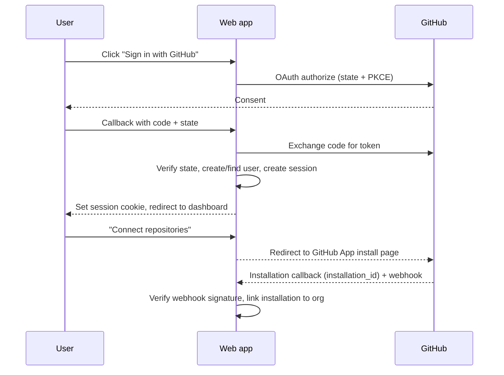
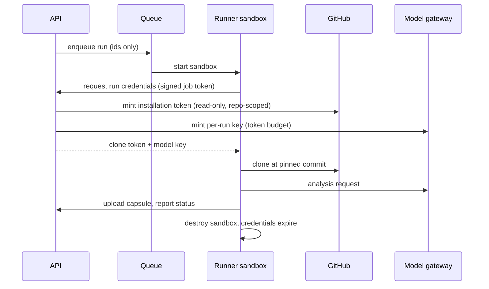
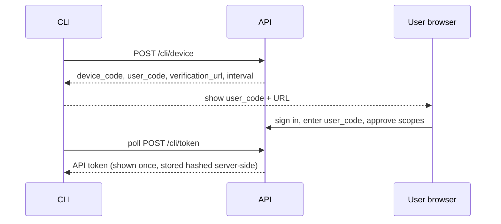

# ExitKit Cloud: Authentication and Authorization Flow

Status: draft v0.1. Library and provider names are proposals; confirm current docs and permissions before implementing.

## 1. Principles
- Least privilege: read-only repository access; writes (draft PRs) only when the user opts in.
- Short-lived credentials; no long-lived GitHub tokens in runners.
- Every request is authenticated, authorised against an org, and audited when it changes state.
- Same rules for browser, API tokens and CLI.

## 2. Identity and access mechanisms

| Mechanism | Used for | Notes |
| --- | --- | --- |
| GitHub OAuth (sign-in) | Proving who the user is | Request minimal scopes (identity and email) |
| GitHub App installation | Repository access | User/org chooses repositories; app requests read-only Contents and Metadata, plus Pull requests write only when PR creation is enabled |
| Session cookie | Browser session | httpOnly, Secure, SameSite=Lax, rotating, server-side session record |
| API token | Scripts and CLI | Hashed at rest, scoped, revocable, shown once |
| CLI device flow (P1) | `exitkit login` | Device code approved in browser, issues an API token |
| Share link token | Read-only capsule viewing | Random, unguessable, stored hashed, expiring, revocable |
| Per-run runner credentials | Sandbox | Clone token (read-only, minutes) and model key (budget-limited, single run) |

SSO (SAML/OIDC) and SCIM are enterprise P2.

## 3. Sign-in and repo connection

Rules:
- `state` is random, single-use and bound to the browser; PKCE is used where supported.
- Redirect URIs are exact-match allow-listed.
- New users get a personal org by default; org membership is created on installation or invite.
- The OAuth access token is not stored unless a feature needs it; installation tokens are minted on demand.

## 4. Run-time credential flow

The signed job token is valid for one run, one sandbox, and short time. The runner has no ability to list other runs, repos or orgs.

## 5. Authorisation model

| Role | Capabilities |
| --- | --- |
| Owner | Everything, billing, delete org, manage members |
| Member | Connect repos, run analyses, view/share capsules, create tokens for self |
| Viewer | View capsules and runs only |

Enforcement:
1. API checks role against `org_id` on every route.
2. Postgres row-level security restricts rows to the caller's orgs (defence in depth).
3. Repository visibility follows GitHub: a user can only analyse repos covered by the org's installation, and an org can only be joined by an invited or GitHub-verified user.
4. Share links grant read access to one capsule only and never expose other runs.

## 6. API tokens and CLI login (P1)

- Scopes: `capsules:write` (push), `runs:read`; default is the narrowest.
- Tokens are stored by the CLI in the OS keychain where available, otherwise a 0600 file.
- Rotation and revocation in Settings; last-used time displayed.

## 7. Session and token hygiene
- Idle and absolute session timeouts; re-authentication for sensitive actions (delete org, create PR, change retention).
- CSRF protection on state-changing browser requests (SameSite plus token for non-GET).
- Rate limiting and lockout on token and device-code endpoints.
- Logout invalidates the server-side session; "sign out everywhere" available.
- Revoking the GitHub App installation immediately blocks new runs and marks repos disconnected.

## 8. Audit events
Sign-in, sign-out, installation linked/removed, run started/cancelled, capsule shared/unshared/deleted, token created/revoked, role changed, data deleted. Each stores actor, org, target, IP and timestamp.

## 9. Failure and edge cases
- Callback with bad or reused `state`: reject and restart flow.
- GitHub revokes access mid-run: clone fails, run fails with a clear reason; no retry loops.
- Expired share link: 410 page with no capsule metadata.
- Removed member: sessions and tokens for that org invalidated.

## 10. To confirm before building
Exact GitHub App permission names and webhook events, device-flow endpoint design, and whether Auth.js or a managed provider is used. Verify against current official docs.
