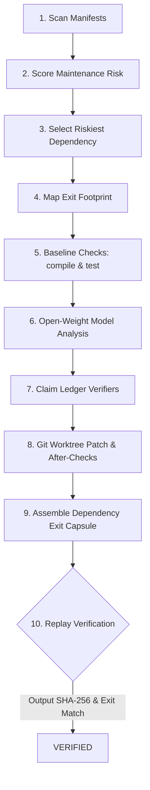

<div align="center">

# ExitKit 🚪⚡

### The Open-Weight AI Dependency Exit Engine & Autonomous Agent Skill

**Safely audit, isolate, and replace risky or vendor-locked dependencies using open-weight AI, deterministic claim verification, and reproducible Dependency Exit Capsules.**

<br/>

[](https://exitkitt.vercel.app/)
[](https://www.npmjs.com/package/exitkit)
[](LICENSE)
[](https://nodejs.org)
[](exitkit/test/)
[](exitkit/package.json)

<br/>

<p align="center">
  <a href="https://exitkitt.vercel.app/"><strong>🌐 Live Web Dashboard</strong></a> •
  <a href="#-quick-start"><strong>⚡ Quick Start</strong></a> •
  <a href="#-the-nine-step-workflow"><strong>🔄 9-Step Workflow</strong></a> •
  <a href="#-agent-skill-integration"><strong>🤖 Agent Skill</strong></a> •
  <a href="#-cli-reference"><strong>💻 CLI Reference</strong></a> •
  <a href="#-github-repository-metadata"><strong>📋 About &amp; Tags</strong></a>
</p>

</div>

---

> [!IMPORTANT]
> **🚀 Hosted Cloud Platform Live at [https://exitkitt.vercel.app/](https://exitkitt.vercel.app/)**
>
> Experience the full web dashboard: scan repositories, launch isolated sandboxes, track 9-step migrations in real time, inspect the deterministic claim ledger, and download shareable **Dependency Exit Capsules**.

---

## 📋 GitHub Repository Metadata

*Copy and paste these exact values into your GitHub repository settings:*

| Setting | Value to Copy |
| :--- | :--- |
| **Description** | `Exit a risky dependency safely: scan, map usage, get an open-weight AI exit plan, cross-check claims with code, apply in an isolated git worktree, and emit reproducible Dependency Exit Capsules.` |
| **Website** | `https://exitkitt.vercel.app/` |
| **Topics / Tags** | `dependency-management`, `migration`, `agent-skill`, `open-weight`, `local-llm`, `provenance`, `cli`, `developer-tools`, `nextjs`, `security-hardening`, `git-worktree` |

---

## 🌟 Why ExitKit?

Every production codebase accumulates risky dependencies: unmaintained packages, breaking API changes, or closed-source proprietary SDKs that lock your product into expensive cloud APIs. 

Traditional AI assistants hallucinate speculative patches and ask developers to blindly "trust" them. **ExitKit flips the paradigm:**

```
Traditional AI Migration:
Prompt LLM ──> Speculative Diff ──> Applied Directly to Working Directory ──> Blind Hope

ExitKit Provenance Pipeline:
Repository ──> AST Usages ──> Open-Weight Model (Hypotheses) ──> Code Ledger Verifiers (CONFIRMED/REFUTED)
                                                                          │
Capsule.json <── Replay Verifier <── After Checks <── Isolated Worktree <──┘
```

### Key Differences

| Feature | Standard Coding Assistants | ExitKit Engine |
| :--- | :--- | :--- |
| **AI Output Trust** | Unchecked prose & hallucinatory claims | Split into atomic claims cross-examined by deterministic verifiers |
| **Working Tree Safety** | Modifies working files directly | **Zero-mutation**: executes strictly in isolated git worktrees |
| **Provenance** | Blurred facts & guesses | Strict tags: `[OBSERVED]`, `[EXECUTED]`, `[AI-GENERATED]` |
| **Verification** | "Looks good to me" | Re-runs baseline & after checks, comparing exit codes and output hashes |
| **Model Freedom** | Closed vendor APIs only | Any OpenAI-compatible open-weight model (Qwen 2.5 Coder, DeepSeek, Llama 3) |
| **Artifact Output** | Ephemeral chat messages | Machine-readable, cryptographically verified `capsule.json` + `capsule.md` |

---

## 🚀 The Nine-Step Workflow



1. **`scan <repo>`**: Discovers all dependencies across `requirements*.txt` and `package.json` with file and line bounds.
2. **`risk <repo>`**: Scores maintenance risks (unbounded versions, vendor lock-in, hardcoded model IDs).
3. **`usages <repo> <pkg>`**: Maps every import, call site, and symbol, calculating exit difficulty.
4. **`checks <repo>`**: Runs baseline compile and test commands. Unexecuted checks are recorded as `not_run`, never hidden.
5. **`analyze <repo> <pkg>`**: Prompts local open-weight model for an atomic exit plan, unified diff, and checkable claims.
6. **`ledger <repo>`**: Cross-examines AI claims with deterministic code verifiers (`CONFIRMED`, `REFUTED`, or `UNVERIFIABLE`).
7. **`patch <repo>`**: Applies unified diff inside a disposable git worktree and re-executes tests.
8. **`capsule <repo>`**: Generates schema-validated `capsule.json` and human-readable `capsule.md`.
9. **`verify <capsule>`**: Replays the recorded commands in a clean sandbox commit to prove reproducibility.

---

## ⚡ Quick Start

### Option 1: Direct via NPX (Zero Install)

Run the full 9-step exit pipeline in one command:
```bash
npx exitkit run ./my-repository --package anthropic --out ./capsule-output
```

With a local open-weight model gateway (Ollama, vLLM, LM Studio):
```bash
export EXITKIT_BASE_URL="http://127.0.0.1:11434/v1"
export EXITKIT_MODEL="qwen2.5-coder-32b-instruct"
export EXITKIT_API_KEY="ollama"

npx exitkit run ./my-repository --package anthropic
```

### Option 2: Verify an Existing Capsule

```bash
npx exitkit verify .exitkit/capsule.json
```

```
PASS  baseline:compile  exit 0  output matches
PASS  after:compile     exit 0  output matches
VERIFIED: recorded results reproduced
```

---

## 🤖 Agent Skill Integration

ExitKit is packaged as a standard **Agent Skill** (`exitkit/SKILL.md`) for pairing with multi-agent coding workflows:

```
                  ┌───────────────────────────────────────────────┐
                  │                 EXITKIT SKILL                 │
                  │              (exitkit/SKILL.md)               │
                  └───────┬───────────────┬───────────────┬───────┘
                          │               │               │
                          ▼               ▼               ▼
                   ┌─────────────┐ ┌─────────────┐ ┌─────────────┐
                   │    Codex    │ │   Claude    │ │ Antigravity │
                   │ Implement & │ │ Adversarial │ │  Builder &  │
                   │ Code Review │ │ Verification│ │ Worktrees   │
                   └─────────────┘ └─────────────┘ └─────────────┘
```

- **Antigravity (Builder)**: Follows the skill to run the CLI, spawn isolated worktrees, and wire the local LLM gateway.
- **Codex (Implementer & Reviewer)**: Audits AST footprints, implements fallback adapters, and validates test suites.
- **Claude (Adversarial Critic)**: Inspects the Claim Ledger, challenges optimistic assumptions, and tests security boundaries.

Point your coding agent to `exitkit/SKILL.md` to begin an automated dependency exit.

---

## 🛡️ Security & Provenance Model

Every statement in an ExitKit Capsule adheres to strict provenance rules enforced in code (`src/provenance.js`):

| Provenance Tag | Source | Guarantee |
| :--- | :--- | :--- |
| **`[OBSERVED]`** | Repository manifests & AST parser | Direct ground truth from disk. AI is forbidden from emitting this tag. |
| **`[EXECUTED]`** | Child process execution | Actual command string, exit code, execution time, and SHA-256 output recorded. |
| **`[AI-GENERATED]`** | Open-weight model gateway | Model hypothesis. Marked unverified until confirmed by code in the ledger. |

### Command Execution Hardening
- Replay commands in `verify` are validated against an allowed executable whitelist (`git`, `python`, `npm`, `npx`, `pytest`, `node`).
- Shell chaining operators (`;`, `&&`, `||`, subshells) are strictly blocked to protect against malicious third-party capsules.
- Working branches are never mutated; changes live exclusively in disposable git worktrees.

---

## 💻 CLI Reference

```bash
exitkit <command> [options]

Commands:
  run <repo> [--package NAME]   Full 9-step pipeline, writes capsule.json + capsule.md
  scan <repo>                   List dependencies (file:line, version bounds)
  risk <repo> [--online]        Maintenance signals per dependency (no CVEs)
  usages <repo> <package>       Usage locations + exit footprint calculation
  checks <repo> [--install]     Baseline and after execution checks
  analyze <repo> <package>      Open-weight model: plan, diff, claims
  ledger <repo>                 Verify AI claims with deterministic checks
  patch <repo>                  Apply unified diff in isolated git worktree
  capsule <repo>                Build and schema-validate the exit capsule
  verify <capsule.json>         Re-run recorded commands and compare hashes

Options:
  --work DIR     Working directory for intermediate files (default .exitkit)
  --out DIR      Capsule output directory (default: work dir)
  --online       Allow registry lookups for stale-package checks
  --install      Run dependency install as part of checks
  --cmd "..."    Extra custom verification smoke command (repeatable)
  --json         Print structured JSON output
```

---

## 🎨 Creative Studio & Interactive Video Footer

The hosted web application at **[https://exitkitt.vercel.app/](https://exitkitt.vercel.app/)** features a responsive creative studio footer with an interactive character video:

- **Cursor-Scrub Eye Tracking**: The character's pupils follow the user's cursor dynamically across the screen using a calibrated non-linear angle lookup table (`gaze-frames.json`).
- **Responsive Layout**: Seamless transition between desktop full-viewport background (`> 700px`) and stacked mobile video (`≤ 700px`).
- **Local Typography**: Styled with local `Epilogue Black` (900) headlines and `DM Sans Regular` (400) body copy.

---

## 🧪 Testing & Verification

ExitKit comes with an automated unit and end-to-end test suite:

```bash
cd exitkit
npm test
```

```
✔ end to end: pipeline, capsule, ledger, verify
✔ without a model the capsule records not_run and an unapplied patch
✔ CLI help and scan run
✔ verifyCapsule rejects untrusted commands in malicious capsule
✔ CLI subcommands enforce prerequisite checks
✔ requirements parser finds names, specs, lines and upper bounds
✔ npm bound detection
✔ usages finds nested imports and footprint
✔ provenance: AI cannot emit OBSERVED or EXECUTED
✔ provenance: verdicts only from ledger, EXECUTED needs cmd+exit
✔ schema validator catches missing and wrong fields
✔ ledger: wrong file list is REFUTED, right is CONFIRMED
✔ command security: isSafeCommand approves standard dev tools and blocks injection
ℹ tests 18 | pass 18 | fail 0
```

---

## 📁 Repository Structure

```
├── app/                       # Next.js 14 Web Application & SaaS Dashboard
│   ├── api/                   # REST API routes (repos, runs, capsules, gateway)
│   ├── brand-logo.tsx         # Outlined vector brand logo component
│   ├── capsules/              # Capsule viewer & visual report pages
│   ├── dashboard/             # SaaS dashboard overview
│   ├── footer-background.tsx  # Cursor-driven eye tracking video controller
│   ├── gaze-frames.json       # Calibrated angle-to-timestamp lookup
│   ├── new/                   # Analysis dispatch wizard
│   ├── page.tsx               # Creative Studio landing page
│   └── runs/                  # Real-time pipeline monitoring & live logs
├── exitkit/                   # Standalone zero-dependency CLI Engine & Skill
│   ├── bin/exitkit.js         # Executable CLI
│   ├── src/                   # Scanner, risk, usages, verifiers, capsule builder
│   ├── references/            # capsule-schema.json & provenance rules
│   ├── SKILL.md               # Self-contained Agent Skill definition
│   └── test/                  # Unit and end-to-end test suite
├── lib/                       # Runner pipeline, in-memory store, models
└── README.md                  # Project documentation
```

---

## 📄 License

MIT © [Ajay Yadav](https://github.com/ajayXcode) — Available freely under the [MIT License](LICENSE).


