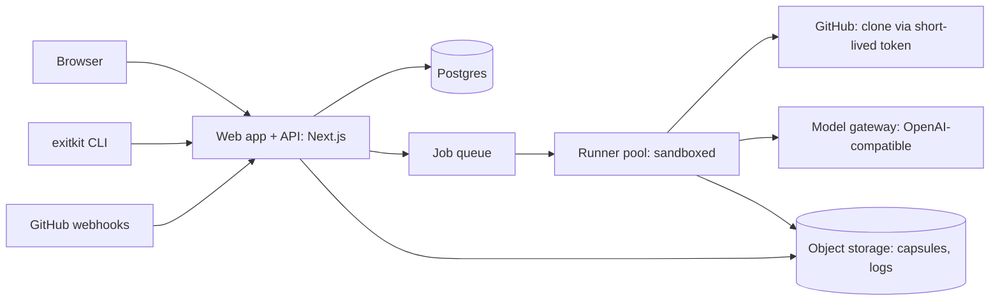

# ExitKit Cloud: Technical Requirements Document (TRD)

Status: draft v0.1 | Companion docs: PRD.md, AUTH_FLOW.md, SECURITY_PLAN.md, IMPLEMENTATION_PLAN.md

## 1. Scope

A multi-tenant web service that runs the ExitKit pipeline on connected repositories. The pipeline code is the existing open-source CLI (`exitkit`, Node 18+); the SaaS wraps it with auth, job orchestration, sandboxed execution, model access, storage and a web UI.

## 2. Architecture

| Component | Responsibility | Choice (proposed) |
| --- | --- | --- |
| Web + API | UI, REST API, auth, webhooks | Next.js (App Router) + TypeScript, matching the supplied website spec |
| DB | Users, orgs, repos, runs, capsules metadata, audit | Postgres with row-level security |
| Queue | Run scheduling, retries, concurrency caps | Postgres-backed queue (e.g. pg-boss) for MVP; revisit if volume grows |
| Runner | Executes `exitkit run` per job in isolation | Ephemeral containers under gVisor or microVMs (Firecracker); one job per sandbox |
| Model gateway | Single OpenAI-compatible endpoint; rate limits, logging without code content | vLLM self-hosted or a hosted open-weight provider; swappable via `EXITKIT_BASE_URL` |
| Object storage | `capsule.json`, `capsule.md`, redacted logs | S3-compatible |

Alternatives to consider: Redis/BullMQ for the queue, Kubernetes Jobs for runners, Supabase/Neon for managed Postgres. Choose after cost and ops review.

## 3. Pipeline execution contract

Per run the runner:
1. Receives `{run_id, repo, ref, package?, extra_cmds[], model}` from the queue (no long-lived secrets).
2. Obtains a short-lived GitHub installation token (read-only contents) and shallow-clones the repo at the pinned commit.
3. Runs `exitkit run <repo> --package 
 --out /out` with `EXITKIT_BASE_URL/MODEL/API_KEY` set to the gateway and a per-run, scoped key.
4. Uploads `capsule.json`, `capsule.md`, redacted logs; posts completion to the API; destroys the sandbox.

The capsule is validated against `references/capsule-schema.json` (schema_version `1.0`) by the CLI and re-validated by the API before it is stored.

### Sandbox requirements
- No access to platform network, metadata endpoints or other tenants.
- Egress allow-list: model gateway, package registries (only when `--install` is enabled), GitHub clone host. Everything else denied.
- No platform secrets in the environment; only the per-run model key and clone token.
- CPU, memory, disk, process-count and wall-clock limits (e.g. 300s per check, overall run cap).
- Read-only base image; writable tmpfs workspace; destroyed after the run.

## 4. Data model (core tables)

| Table | Key columns |
| --- | --- |
| users | id, github_id, email, created_at |
| orgs / memberships | org_id, user_id, role (owner, member, viewer) |
| github_installations | id, org_id, installation_id, repo_selection |
| repos | id, org_id, full_name, default_branch |
| runs | id, org_id, repo_id, commit, package, status (queued, running, succeeded, failed, cancelled), model, started_at, finished_at, error |
| capsules | id, run_id, schema_version, storage_key, accuracy_confirmed/refuted/unverifiable, change_status (proposed, applied, verified), share_token_hash, share_expires_at |
| api_tokens | id, user_id, name, token_hash, last_used_at, revoked_at |
| audit_log | id, org_id, actor_id, action, target, ip, created_at |
| usage_events | id, org_id, run_id, tokens_in, tokens_out, sandbox_seconds |

All tenant tables carry `org_id` and are protected by RLS policies; application code also filters by org (defence in depth).

## 5. API (REST, JSON, versioned `/api/v1`)

| Method and path | Purpose |
| --- | --- |
| GET /repos | List connected repos |
| GET /repos/:id/dependencies | Scan + risk ranking (cached by commit) |
| POST /runs | Start analysis `{repo_id, ref, package?, extra_cmds?}` |
| GET /runs/:id | Status and step progress |
| POST /runs/:id/cancel | Cancel |
| GET /capsules/:id | Metadata; `/capsules/:id/capsule.json` and `.md` downloads |
| POST /capsules/:id/share | Create revocable share link; DELETE to revoke |
| POST /capsules/:id/pr | (P1) open draft PR from applied branch |
| POST /cli/device, POST /cli/token | (P1) CLI device login |
| POST /capsules (CLI upload) | (P1) `exitkit push`, schema-validated |
| POST /webhooks/github | Installation and push events (signature verified) |

Conventions: idempotency keys on POST /runs, cursor pagination, uniform error body `{error:{code,message}}`, per-user and per-org rate limits.

## 6. Capsule and schema versioning

- `schema_version` is required; breaking changes bump the version and the API keeps readers for old versions.
- Provenance rules are part of the contract: the API rejects capsules where an AI-sourced entry is tagged OBSERVED/EXECUTED, or where a verdict lacks ledger provenance (same rules as `src/provenance.js`).
- Stored capsules are immutable; re-runs create new capsules.

## 7. Model gateway

- OpenAI-compatible `/v1/chat/completions`; model name configurable per plan.
- Prompt contains only the dependency usage snippets and footprint, not the whole repo.
- Gateway logs metadata (tokens, latency, model, run_id) but not prompt/response bodies by default.
- Per-run key with token budget; timeout 300s; one retry handled by the CLI.
- Model license and hardware requirements must be recorded in the release notes for each supported model.

## 8. Frontend requirements

- Next.js App Router, React, TypeScript, ordinary CSS (consistent with the supplied footer source).
- Marketing page and app share design tokens defined in UI_UX_FLOW.md.
- Capsule viewer renders `capsule.json` client-side from the stored schema; no server-side HTML from model text (escape everything; render diffs as text).
- Responsive at 320px, 390px and above 700px.

## 9. Non-functional requirements

| Area | Requirement (initial targets, to validate) |
| --- | --- |
| Availability | Web/API 99.5% monthly for MVP |
| Run latency | Queue-to-start under 60s at typical load; total run time dominated by model and repo checks |
| Isolation | One sandbox per run; no reuse |
| Observability | Structured logs with run_id, metrics (queue depth, run duration, failure reasons), traces across API-queue-runner |
| Cost control | Per-org concurrency and monthly run quotas; sandbox and token usage recorded per run |
| Data retention | Configurable; default capsules kept until deleted, logs 30 days, cloned repos deleted at run end |
| Accessibility | WCAG 2.2 AA for the app |

## 10. Testing strategy

- Unit: CLI modules (existing 15 tests: scanner, usages, provenance, schema, verifiers, e2e with mock model server).
- API: contract tests, RLS tests (cross-tenant access must fail), webhook signature tests.
- Runner: sandbox escape and egress tests (attempts to reach metadata IP, other tenants, arbitrary hosts must fail).
- E2E: Playwright flows (connect repo, run, view capsule, share, revoke).
- Golden capsules: fixtures with known verdicts to catch regressions in verifiers and renderers.

## 11. Deployment

- Environments: dev, staging, prod; infrastructure as code.
- CI: lint, tests, dependency audit, container scan; npm publish of the CLI with provenance on tags.
- Secrets in a managed secret store; no secrets in images.
- Database migrations are forward-only with rollback plan; backups with tested restore.

## 12. Known gaps (be honest)

- The CLI currently verifies only `only_used_in` and `schema_compat` claims; `runtime_behavior` is UNVERIFIABLE until the fake-server check is built.
- Usage detection is line-based, not a full AST.
- `exitkit login` / `push` and the GitHub App integration are planned, not built.
- Sandbox technology choice (gVisor vs Firecracker vs managed service) needs a spike.
