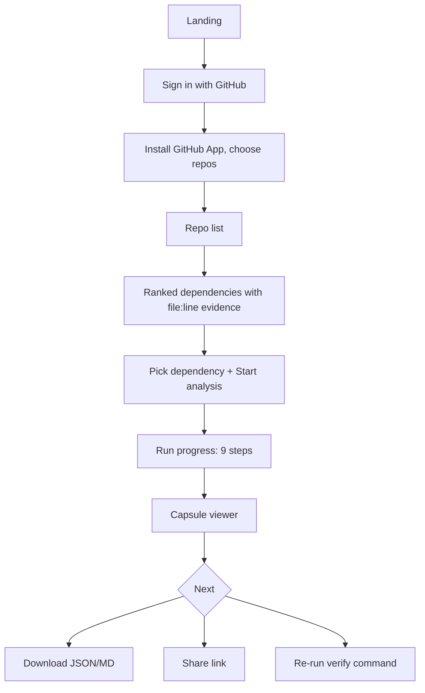

# ExitKit Cloud: UI and UX Flow

Status: draft v0.1. Built from the two pasted website/UI specs (they were identical: a single-page footer with a script logo, two text columns, three social icons and an eye-tracking lavender character video). Anything not in those specs is a proposal and is marked as such.

## 1. Design foundation (taken from the supplied spec)

| Token | Value | Source |
| --- | --- | --- |
| Text and logo | #080909 | spec |
| Desktop fallback background | #dfe4f2 | spec |
| Mobile body/footer background | #f0eefa | spec |
| Badge background | #f7f8fa | spec |
| Headline font | Epilogue Black, weight 900 | spec |
| Body font | DM Sans Regular, weight 400 | spec |
| Font rules | Real font files, `font-synthesis: none`, `font-display: swap` | spec |
| Mobile breakpoint | 700px | spec |
| Style | Spacious, minimal, no gradients, shadows, scrims or decorative borders | spec |

Proposal (not in spec): reuse these tokens across the whole app so marketing site and product feel like one brand. Provenance colours below are new and must be checked for contrast against #f0eefa and #ffffff.

## 2. Marketing site: footer (exact per spec)

The pasted spec describes only the footer page. Build it as supplied; do not redesign.

- Desktop (>700px): left column (badge, two-line headline, four nav-style labels), absolutely positioned script logo at left 40.33vw / top 7.7vw / width 17vw, right column (badge, two-line headline, note, three social icons), lavender character video filling the viewport behind content (z-index -1, no overlay).
- Mobile (<=700px): stacked order logo, left block, right block, video (full bleed, 4/3, below content).
- Interaction: desktop video is paused and scrubbed by cursor angle using the supplied `gaze-frames.json` lookup and `FooterBackground` component; mobile plays the clip muted and looping, paused under `prefers-reduced-motion`.
- Semantics: `footer` with `aria-label="Footer"`; logo `role="img"`; social wrappers labelled LinkedIn, Instagram, TikTok; nav labels, logo and icons are static, not links.
- Assets: fonts and video must be downloaded from the URLs given in the spec and served locally; the video is transcoded to an all-intra `footer-scrub.mp4` with the supplied ffmpeg command.

Gaps and decisions needed before building:
1. **Icon files missing.** The spec ends with "find linkedin / insta / simple tiktok icon" and no SVG content. They must be sourced or drawn; the spec says "exact SVG files", which were not supplied.
2. **Copy is placeholder studio copy** ("have a fresh idea?", "imagination meets craft", "say hey"). The spec says not to rewrite it, but it does not describe ExitKit. Recommended: keep layout, tokens and character counts, and swap copy to ExitKit wording of the same length, after you approve. Until then the footer should be built with the supplied copy.
3. **Logo is a "Logoipsum" placeholder.** Replace with the ExitKit logo only if you supply an SVG; otherwise keep the placeholder.
4. **Nav labels are non-clickable by spec.** For a real product footer you will want real links; that contradicts the spec, so it is a decision for you.

## 3. Information architecture (proposal)

```
Marketing (public)         App (signed in)
  Home / footer              Dashboard
  Docs (CLI)                 Repos
  Pricing                      Repo detail -> dependencies (ranked)
  Sign in                    New analysis (wizard)
                             Runs
                               Run detail (live progress)
                             Capsules
                               Capsule viewer
                             Team (members, roles)       [P1]
                             Settings (tokens, data, billing)
```

## 4. Core user flows

### Flow A: first run


### Flow B: review a shared capsule (no account needed for viewing)
Open link, see read-only capsule with banner "Shared by <name>", copy the `exitkit verify` command, optionally sign in to run your own.

### Flow C: CLI user (P1)
`exitkit login` shows a code and URL; approve in browser; `exitkit push capsule.json` appears in Capsules with a "Uploaded from CLI" label.

## 5. Screen specifications

### 5.1 Dependencies (repo detail)
- Table: dependency, spec, risk score, signals (chips), manifest file:line.
- Row action: "Analyse exit". Empty state: "No dependencies found. We looked for requirements*.txt and package.json."
- Note line: "Security vulnerabilities are not scanned."

### 5.2 New analysis wizard (3 steps, one screen each on mobile)
1. Dependency and ref (branch or commit shown, pinned to commit).
2. Optional checks: extra smoke commands (text inputs), install dependencies toggle with warning "runs in an isolated sandbox".
3. Review and Start. Show model name and what leaves the repo ("Only usage snippets are sent to the model").

### 5.3 Run detail
- Vertical stepper of the nine pipeline steps: scan, risk, select, usages, baseline, AI analysis, ledger, patch + after-checks, capsule.
- Each step: status (queued, running, done, failed, not_run) with a text label, duration and a "show log" disclosure (redacted).
- Failure states are explicit, with the reason from the capsule.

### 5.4 Capsule viewer (the product's centre)
Sections in order, each collapsible and deep-linkable:
1. Header: dependency, repo@commit, change status chip (proposed / applied / verified), claim accuracy "9 claims: 6 confirmed, 1 refuted, 2 unverifiable".
2. **Needs attention** panel first: refuted claims, failed checks, not_run checks with reasons, unresolved concerns.
3. Risk indicators with evidence links (file:line).
4. Usage and footprint: locations, symbols, call sites, exit difficulty with the formula shown.
5. Claim Ledger table: claim, type, verdict, evidence (expandable).
6. Proposed change: diff (monospace, text-only rendering), status explanation of proposed / applied / verified.
7. Verification: baseline vs after table with regression column; commands and exit codes; comparison method sentence.
8. Gaps and limitations; out-of-scope statement.
9. Footer actions: Download JSON, Download Markdown, Share, Copy verify command.

### 5.5 Provenance badges (new, proposal)
| Tag | Label | Icon | Notes |
| --- | --- | --- | --- |
| OBSERVED | Observed | eye | read from files |
| EXECUTED | Executed | terminal | command + exit code available on hover/focus |
| AI-GENERATED | AI | sparkle | always shown with its verdict when present |

Verdict chips: CONFIRMED (check), REFUTED (cross), UNVERIFIABLE (question mark). Never rely on colour alone: each chip has an icon and text. REFUTED and failed items use the strongest emphasis.

### 5.6 Share dialog
Create link, set expiry, copy, revoke. Copy: "Anyone with the link can view this capsule. It may contain code snippets and file paths."

### 5.7 Settings
API tokens (create/revoke), connected GitHub installations, data retention, delete repo data, delete account.

## 6. Content and tone

Plain, direct, evidence-first. Prefer "Refuted by code check" over "Model was wrong". Never present AI text without its tag. Avoid hype; show counts.

## 7. States and edge cases
- Empty repo list, GitHub App not installed, repo access revoked mid-run.
- No tests found: show as `not_run` with reason, not as success.
- Model unavailable or invalid JSON twice: run completes with AI analysis `failed`, capsule still produced.
- Patch fails `git apply --check`: status stays "proposed" with the error text.
- Dirty or unknown commit: banner on capsule.

## 8. Responsive and accessibility
- Breakpoint 700px as in the spec; verify at 320px, 390px and desktop widths.
- Tables become stacked cards on mobile; diffs scroll horizontally inside their own container.
- Touch targets at least 44px (the spec already uses 44px wrappers on mobile).
- Keyboard-operable steppers, disclosures and dialogs; visible focus; ARIA labels for chips and icons.
- Respect `prefers-reduced-motion`; no autoplay motion in the app UI. The footer video follows the spec.
- Target WCAG 2.2 AA; verify contrast of every chip colour.

## 9. Analytics and feedback (proposal)
Event names only, no code content: run_started, run_completed, capsule_viewed, capsule_shared, verify_command_copied. Provide a "Report a bad verdict" action on each ledger row.
